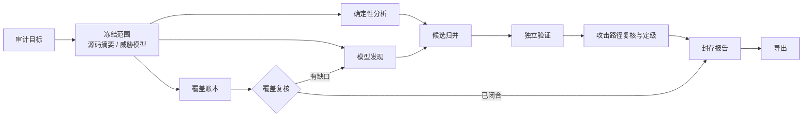

# EdgeAudit

[](LICENSE)
[](package.json)
[](#环境要求)

EdgeAudit 是 DeepSeek Harness（DSH）的代码安全审计插件，名称取自棱角社区（EdgeSecurity）。

插件把一次审计拆成发现、独立验证、攻击路径复核和覆盖复核几个阶段，分别在不同的 DSH Session 中执行。每条确认的发现都带有源码位置、数据流路径、已有防护和成立前提；证据不足的候选单独列为“待验证”。报告可以导出为 Markdown、HTML、JSON、SARIF 和 CSV。

English: EdgeAudit is a code security audit plugin for DeepSeek Harness. It combines deterministic AST/data-flow analysis with model-driven discovery, runs validation and attack-path review in separate sessions, tracks coverage in a ledger, and exports reports as Markdown, HTML, JSON, SARIF or CSV.

## 目录

- [功能](#功能)
- [环境要求](#环境要求)
- [安装](#安装)
- [使用](#使用)
- [配置](#配置)
- [工具列表](#工具列表)
- [安全模型](#安全模型)
- [开发与测试](#开发与测试)
- [常见问题](#常见问题)
- [来源与许可](#来源与许可)

## 功能

- 三种审计模式：Standard（全仓或子目录）、Diff（工作树、单个提交或分支差异）、Deep（多轮发现与归并）。
- 确定性分析：JS/TS 基于 AST 做跨模块追踪；Python、Go、Java、C#、PHP、Ruby、C/C++、Rust 使用结构化数据流规则。设置 `discovery=engine` 时不调用模型。
- 模型发现：用于鉴权、对象授权、租户隔离、业务状态机等规则难以覆盖的问题。
- 独立验证：验证者在新 Session 中重新读取源码并寻找反证，看不到发现阶段的结论。严重度按影响和可能性计算，不由模型直接给出。
- 证据分级：运行时确认、静态确认、待验证、已排除。
- 覆盖账本：记录已审、跳过和缺少证据的范围，由独立的 Critic 复核并在预算内补审。
- 中断恢复：任务状态持久化；源码变化后拒绝在旧记录上继续。
- 动态验证（可选）：在无网络、只读根文件系统、非 root 的 Docker 容器中运行经过审批的命令。
- 修复闭环：生成精确行范围的补丁，应用前记录回滚信息，修复后独立复验。
- 外部告警导入：SARIF/JSON/文本、GitHub Code Scanning、Dependabot、Jira、Linear。

各语言的分析边界见 [docs/evidence-contract.md](docs/evidence-contract.md#per-language-analysis-boundaries)。

### 审计流程



## 环境要求

- DSH Desktop `0.2.1-rc.5`。首次使用前打开一次以初始化 Profile，然后完全退出。
- Node.js `>= 22.19.0`、npm、Git。
- Docker，仅动态验证需要。

## 安装

安装前先完全退出 DSH Desktop。

```sh
git clone https://github.com/r0eXpeR/dsh-edge-audit.git
cd dsh-edge-audit
npm ci --ignore-scripts
npm pack
dsh plugin --profile desktop add "file:$(pwd)/dsh-edge-audit-$(node -p "require('./package.json').version").tgz" --ignore-scripts
```

`npm pack` 会构建 `dist/`、校验随包 Skill，并在当前目录生成 `dsh-edge-audit-<版本>.tgz`。插件安装到 DSH Profile 的是这个归档，安装完成后可以删除源码目录。

使用其他 Profile 时，把 `--profile desktop` 换成对应名称（例如命令行版本常用的 `web`）。

启动 Desktop，在会话中让模型调用 `security_list_skills`，返回 8 个 `dsh-edge-*` Skill 即为加载成功。

升级：在源码目录 `git pull` 后重新执行 `npm ci --ignore-scripts`、`npm pack` 和上面的 `dsh plugin add` 命令。

加载失败时，检查 Profile 目录下 `package.json` 的 `dsh.profile.bundles`。Profile 默认在 `~/.dsh/profiles/desktop`，设置了 `DSH_HOME` 时在 `$DSH_HOME/profiles/desktop`。

卸载（先完全退出 Desktop）：

```sh
dsh plugin --profile desktop remove dsh-edge-audit
```

## 使用

插件通过工具调用使用。在 DSH 中打开要审计的工作区，用自然语言让模型调用对应工具即可。只审计你拥有或已获书面授权的代码。

### 第一次审计

```text
调用 security_scan，mode=standard，审计当前工作区。
重点检查 API 的身份认证、对象授权和租户隔离，只使用静态源码证据。
返回 scanId，分别列出确认发现、待验证候选和覆盖缺口，每条结论给出文件和行号。
```

审计结束后导出报告：

```text
调用 security_export_scan，scan_id=<scanId>，format=html，保存到 reports/audit.html。
```

`security_export_scan` 返回报告内容，由模型写入你指定的位置。封存的原始记录保存在 `<状态目录>/artifacts/<项目名>/<scanId>/`，包括 `scan-manifest.json`、`coverage.json`、`findings.json` 和报告，可以用 `security_verify_scan_bundle` 校验完整性。

### 审计模式

| 模式 | 工具 | 适用场景 |
| --- | --- | --- |
| Standard | `security_scan` | 全仓或单个模块的常规审计 |
| Diff | `security_review_diff` | PR、提交或分支引入的改动 |
| Deep | `security_run_deep_investigation` | 大型系统，多轮独立发现后归并复核，耗时和模型用量都明显更高 |

Standard 和 Diff 默认 `discovery=llm`，使用当前 DSH Profile 配置的模型。`discovery=engine` 只做确定性分析，候选会保留，之后可以继续验证。

Diff 的 `mode` 参数：

- `working_tree`：工作树相对 HEAD 的改动，包括暂存区和未跟踪的文本文件。
- `commit`：配合 `base=<commit>` 审计单个提交。
- `branch_diff`：配合 `base=<branch>`，以 merge-base 为基准审计整条分支。

```text
调用 security_review_diff，mode=branch_diff，base=main，审计当前分支相对 main 引入的风险。
```

### 限定范围

用 `path` 限定目录，`threat_model` 写需要成立的安全约束，`context` 写角色和部署信息：

```text
调用 security_scan，path=src/billing，mode=standard。
threat_model：只有所属组织的成员可以读取账单；管理员同样需要校验组织归属。
context：多租户 SaaS，网关已校验 JWT，org_id 来自 token claim。
```

[docs/prompts/](docs/prompts/) 下有两份完整的提示词模板：[日常安全审计](docs/prompts/daily-security-audit.md) 和 [RCE 深度审计](docs/prompts/deep-rce-audit.md)。

### 查看进度与恢复

| 用途 | 工具 |
| --- | --- |
| 查看审计记录和覆盖情况 | `security_get_scan`、`security_get_coverage` |
| 查询进度和中断原因 | `security_get_investigation_status` |
| 恢复中断的审计 | `security_resume_standard_scan`、`security_resume_diff_scan`、`security_resume_deep_investigation` |
| 验证剩余候选 | `security_validate_scan` |
| 补审覆盖缺口 | `security_review_coverage` |
| 继续追踪单个候选 | `security_start_candidate_followup` |

`security_get_investigation_status` 会区分超时、源码变化和预算耗尽，并给出应使用的恢复工具和 `job_id`。

状态为 `completed` 只表示流程已封存，报告中仍可能有待验证（Needs Validation）的候选，需要按报告列出的缺失前提继续核对。

### 动态验证

静态证据不足时，可以在 Docker 中运行测试或复现命令，结果作为运行记录附加到候选上：

1. 在配置中设置 `validationSandbox`。
2. 调用 `security_plan_candidate_validation` 生成验证计划，命令从项目清单推导。
3. 审查命令后调用 `security_run_candidate_validation_plan`，传入 `approved: true`，并在 DSH 审批弹窗中确认。

运行记录只作为证据，不会自动把候选改为确认。

### 修复与复验

| 步骤 | 工具 |
| --- | --- |
| 生成补丁（需要已验证的发现） | `security_propose_reviewed_remediation` |
| 应用补丁（需审批） | `security_apply_remediation` |
| 在沙箱中运行项目检查 | `security_run_remediation_verification` |
| 记录独立复验结果 | `security_record_revalidation` |
| 回滚 | `security_rollback_remediation` |

`security_fix_finding` 按顺序执行以上步骤。`security_compare_scans` 用于对比修复前后两次审计。

### 导入外部告警

| 来源 | 工具 |
| --- | --- |
| 本地 SARIF / JSON / 文本 | `security_import_findings` |
| GitHub Code Scanning、Dependabot、安全通告 | `security_import_github_findings` |
| Jira、Linear | `security_import_ticket_findings` |
| 批量分诊 | `security_triage_finding_backlog` |

导入的告警会对照当前源码重新分诊，分诊结果不能代替验证。

### 其他

- 单条漏洞报告：`security_finding_writeup`。
- 创建外部工单或 GitHub 私有安全通告：先用 `security_tracking_preview` 或 `security_tracking_advisory_preview` 预览，审批后再创建。
- 批量审计多个子项目：`security_bulk_scan`，或 `security_bulk_scan_csv`（CSV 需要 `path` 列，最多 500 行）。

## 配置

在 Desktop Profile 的 `cordis.patch.yml` 中添加：

```yaml
- id: dsh-edge-audit
  config:
    enabled: true
    maxFiles: 500
    maxFileBytes: 262144
    maxTotalBytes: 67108864
    maxConcurrentModelWorkers: 3
    workerTimeoutMs: 180000
    maxAuditTimeHours: 2
    # maxModelTokens: 200000
    # stateDir: /secure/path
    # knowledgeBase: [docs/security]
    # scanPrompt: "关注支付回调的签名校验"
    # filterInstructions: "内部管理端仅限 VPN 访问"
    # credentialRefs:
    #   - id: github
    #     environment: GITHUB_TOKEN
    #     origins: [https://api.github.com]
    # validationSandbox:
    #   executable: /usr/local/bin/docker
    #   image: sha256:<64 位本地镜像 ID>
    #   socket: /Users/me/.colima/default/docker.sock
    # deepScan:
    #   workers: auto
    #   subagents: 3
    #   maxDiscoveryRuns: 60
    #   maxTimeHours: 96
```

| 配置项 | 默认值 | 说明 |
| --- | --- | --- |
| `maxFiles` | 500 | 单次审计的文件数上限，1–10000 |
| `maxFileBytes` | 262144 | 单个文件读取上限，1 KB–10 MB |
| `maxTotalBytes` | 64 MB | 总读取上限，1 MB–512 MB |
| `maxConcurrentModelWorkers` | 6 | 模型任务并发数，1–32 |
| `workerTimeoutMs` | 180000 | 单个模型任务超时，1 秒–1 小时 |
| `maxAuditTimeHours` | 4 | Standard / Diff 总时限，恢复后不重新计时，0.01–96 |
| `maxCoverageWaves` | 6 | 覆盖补审轮数上限，用完后记为 incomplete |
| `discoveryBatchRegions` | 6 | 单个模型批次包含的源码区域数 |
| `investigatorConcurrency` | 5 | Standard 专项调查并发数 |
| `maxModelTokens` | 无 | 按已记录用量判断的软上限，已派发的任务仍可能超出 |
| `stateDir` | `~/.dsh-edge-audit` | 审计状态目录，见下文 |
| `knowledgeBase` | 无 | 只读的内部安全文档（Markdown、文本、PDF、DOCX） |
| `scanPrompt` | 无 | 提供给所有审计 Worker 的补充说明 |
| `filterInstructions` | 无 | 运维方提供的误报判定说明，只提供给验证者 |
| `credentialRefs` | 无 | 外部平台凭据，按环境变量名引用并绑定 Origin |
| `validationSandbox` | 无 | 动态验证使用的 Docker；`socket` 默认 `/var/run/docker.sock` |

状态目录按以下顺序确定：`stateDir` 配置、环境变量 `DSH_EDGE_AUDIT_STATE_DIR`、默认目录 `~/.dsh-edge-audit`。目录中可能包含源码片段和漏洞细节，以 `0700/0600` 权限创建，请放在受控位置。

## 工具列表

插件共注册 98 个工具。日常使用前面几组即可，其余由内部的 Worker、验证者和 Critic 在各自的 Session 中调用。标 * 的工具会修改文件、执行命令或写入外部系统，需要同时传入 `approved: true` 并通过 DSH 审批。

<details>
<summary>展开</summary>

| 分组 | 工具 |
| --- | --- |
| 审计入口 | `security_scan` `security_review_diff` `security_run_deep_investigation` `security_bulk_scan` `security_bulk_scan_csv` `security_rerun_scan` `security_assess` |
| 结果与导出 | `security_get_scan` `security_get_coverage` `security_scan_history` `security_export_scan` `security_verify_scan_bundle` `security_finding_writeup` `security_compare_scans` `security_get_investigation_status` |
| 恢复与续审 | `security_resume_standard_scan` `security_resume_diff_scan` `security_resume_deep_investigation` `security_resume_deep_discovery` `security_resume_deep_closure` `security_resume_investigation` `security_resume_bulk_scan` `security_validate_scan` `security_review_coverage` `security_start_candidate_followup` `security_cancel_investigation` |
| 验证与定级 | `security_claim_audit_task` `security_pending_candidates` `security_record_validation` `security_record_attack_path` `security_record_triage_decision` `security_attach_evidence_locations` `security_validation_guidance` `security_attack_path_guidance` `security_finalize_investigation` |
| 动态验证 * | `security_plan_candidate_validation` `security_run_validation` `security_run_candidate_validation` `security_run_candidate_validation_plan` `security_run_candidate_runtime_validation` |
| 修复 * | `security_remediation_plan` `security_propose_reviewed_remediation` `security_get_remediation` `security_apply_remediation` `security_run_remediation_verification` `security_rollback_remediation` `security_fix_finding` `security_record_revalidation` `security_get_revalidation` `security_update_finding` `security_hardening_proposal` |
| 导入与分诊 | `security_import_findings` `security_import_github_findings` `security_import_ticket_findings` `security_triage_imported_finding` `security_triage_finding_backlog` |
| 外部跟踪 * | `security_tracking_preview` `security_tracking_advisory_preview` `security_create_tracking_issue` `security_create_github_security_advisory` `security_install_precommit_hook` |
| Skill 与上下文 | `security_list_skills` `security_read_skill` `security_threat_model_template` `security_writeup_guidance` `security_read_scan_context` `security_read_scan_source` |
| 内部协议 | `security_llm_*` `security_diff_*` `security_deep_*` `security_disclosure_*` `security_record_coverage_check` `security_report_coverage_critic` `security_start_*` |

</details>

随包 Skill：

| Skill | 用途 |
| --- | --- |
| `dsh-edge-audit` | 审计入口与模式选择 |
| `dsh-edge-discovery` | 架构梳理、发现与变体追踪，附 10 个领域的参考材料 |
| `dsh-edge-coverage` | 覆盖账本与缺口补审 |
| `dsh-edge-validation` | 独立验证与常见误报 |
| `dsh-edge-attack-path` | 攻击路径复核与定级 |
| `dsh-edge-remediation` | 补丁审查、应用与复验 |
| `dsh-edge-report` | 报告写作 |
| `dsh-edge-triage` | 外部告警与历史结论复核 |

插件只读取随包的 Skill，不加载被审计仓库中的 Skill。

## 安全模型

插件假设被审计的仓库不可信：

| 风险 | 处理方式 |
| --- | --- |
| 恶意 Git 配置执行命令或读取宿主文件 | 禁用 Hooks、fsmonitor、外部 diff、textconv，覆盖仓库本地的 filter/diff/merge 驱动；用命令行固定仓库与工作树位置，拒绝隐式裸仓库；忽略全局和系统 Git 配置 |
| 符号链接读取宿主文件 | 审计目标、补丁路径和输入文件逐级拒绝符号链接，只接受常规文件 |
| 提示注入诱导写操作 | 写操作需要 `approved: true` 和 DSH 审批，模型参数本身无法授权 |
| 执行不可信代码 | 只在 Docker 中执行：`--network none`、`--read-only`、`--cap-drop ALL`、`no-new-privileges`、uid 65534，限制 CPU、内存、进程数和文件大小；镜像以 `sha256` 固定，不拉取远程镜像 |
| 凭据泄露 | 凭据绑定 Origin，跨域不转发 Authorization，禁止重定向，输出统一脱敏 |
| 报告 XSS | HTML 报告转义所有字段，使用基于哈希的 CSP |

漏洞报告方式见 [SECURITY.md](SECURITY.md)。

## 开发与测试

```sh
npm ci --ignore-scripts
npm run typecheck
npm run check:skills
npm run check:dsh-runtime
npm test
npm run benchmark:golden
```

`npm test` 包含 422 个用例，Docker 集成用例默认跳过，开启方法见 [CONTRIBUTING.md](CONTRIBUTING.md)。

`benchmark:golden` 在 31 个确定性合成样本（JS/TS、Python、Go、PHP、Java、C#、Ruby、C、C++、Rust）上评测候选定位。当前结果：19 个目标位置全部命中，误报 0，行号偏差 0。这只衡量合成样本上的确定性定位，不代表真实项目的检出率或误报率，方法见 [docs/security-golden-corpus-benchmark.md](docs/security-golden-corpus-benchmark.md)。

## 常见问题

**和 Semgrep、CodeQL 的关系**

可以配合使用。规则型 SAST 适合覆盖已知模式，EdgeAudit 侧重对象授权、租户隔离、跨模块权限这类需要理解业务的问题。SAST 的 SARIF 结果可以用 `security_import_findings` 导入后复核。

**源码会发送到哪里**

`discovery=llm` 时，源码上下文会发送给当前 DSH Profile 配置的模型服务。`discovery=engine` 只在本地运行。

**为什么审计完还有“待验证”**

证据不足以确认。报告会列出缺少的前提，例如部署配置或运行时行为。补充 `context` 后可以用 `security_start_candidate_followup` 继续，或者走动态验证。

**审计中断了**

调用 `security_get_investigation_status` 查看原因和恢复方式。源码变化后旧记录会拒绝恢复，需要重新审计。

**macOS 上提示沙箱不可用**

`executable` 必须是绝对路径，`image` 必须是 `sha256:` 开头的本地镜像 ID（`docker image inspect --format '{{.Id}}' <镜像>`）。使用 Colima 或 OrbStack 时需要设置 `validationSandbox.socket`。

## 来源与许可

EdgeAudit 基于 [Zenquiem/dsh-security-suite](https://github.com/Zenquiem/dsh-security-suite)（Apache-2.0）0.54.28 开发。原项目提供了 DSH 插件框架、Standard/Diff/Deep 扫描流程、验证与攻击路径收据、外部跟踪和导出功能；本项目在此基础上改写了分析引擎、覆盖账本、恢复机制和安全加固，并更名发布。

部分方法和参考材料改编自以下项目：

- [Cloudflare security-audit-skill](https://github.com/cloudflare/security-audit-skill)（MIT）：覆盖账本、独立覆盖复核、缺口补审和十个领域的参考材料。
- [OpenAI Codex Security](https://github.com/openai/codex-security)（Apache-2.0）：基线调查、多轮审计、候选归并、结构化证据；威胁模型、验证与定级规则。
- [Anthropic claude-code-security-review](https://github.com/anthropics/claude-code-security-review)（MIT）：增量审计的上下文分析和常见误报先例。

改编范围见 [docs/security-source-attribution.md](docs/security-source-attribution.md) 和 [NOTICE](NOTICE)。

贡献方式见 [CONTRIBUTING.md](CONTRIBUTING.md)，版本记录见 [CHANGELOG.md](CHANGELOG.md)。

本项目以 [Apache-2.0](LICENSE) 许可发布，第三方许可见 [docs/licenses](docs/licenses/)。
